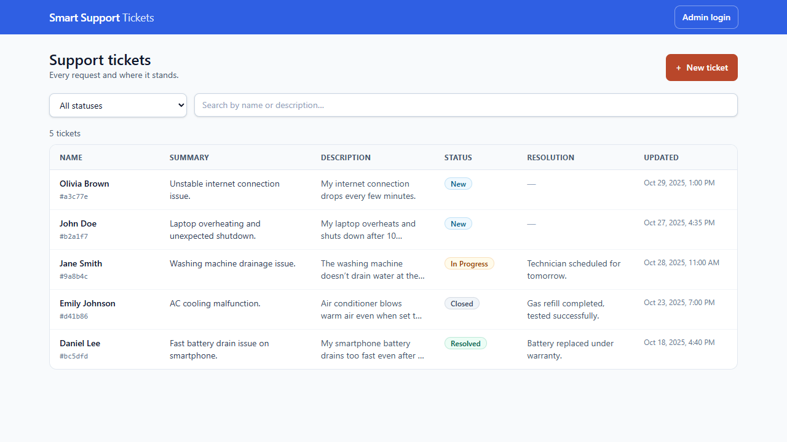
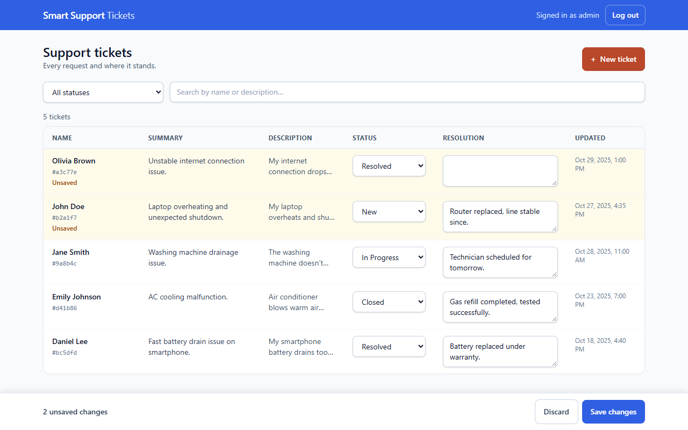
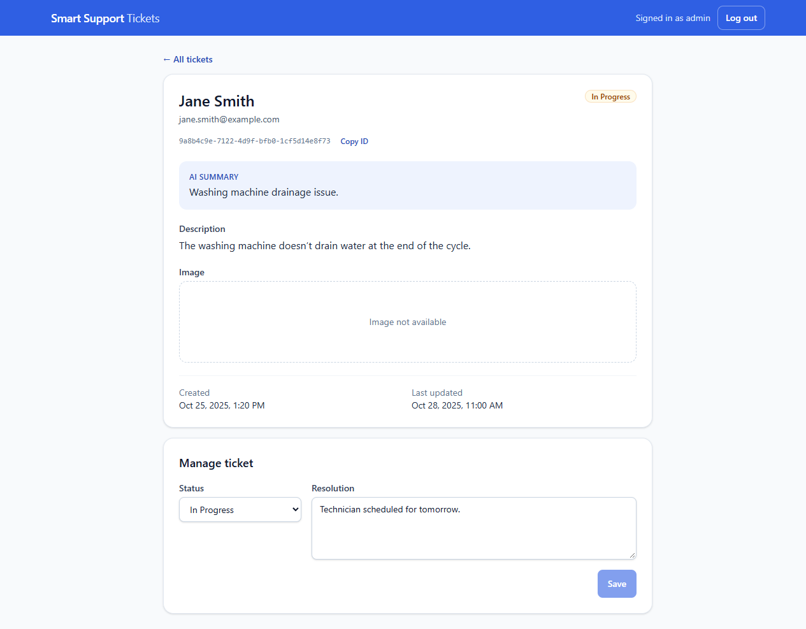
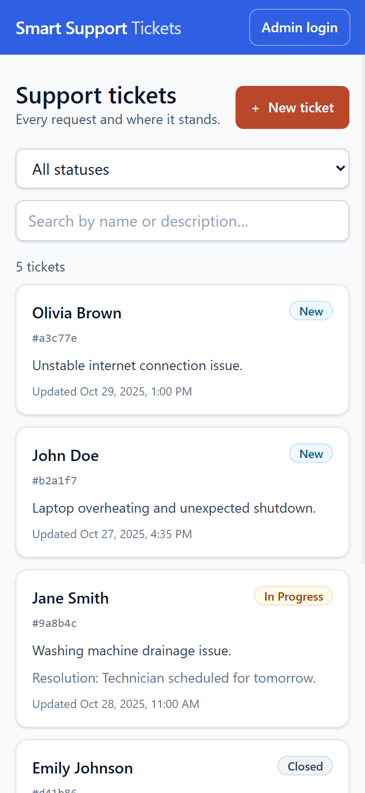
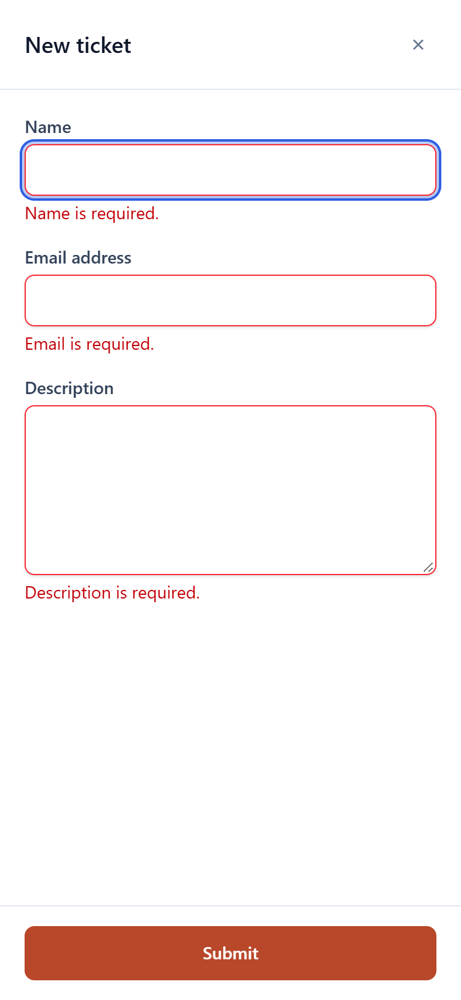
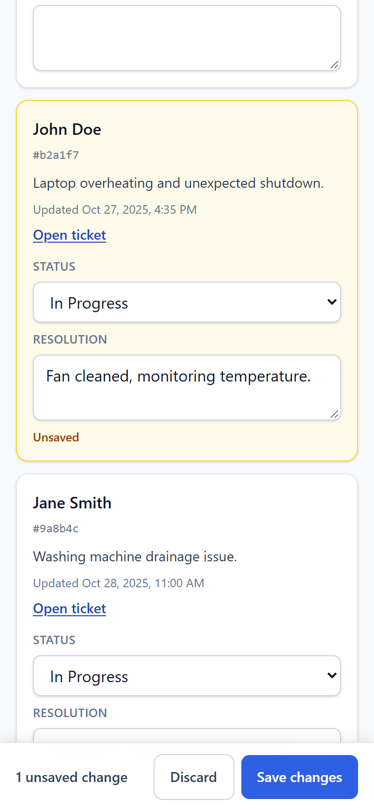

# Smart Support Tickets

A customer support ticket system: customers open tickets (an AI writes a one-line summary while the ticket is
saved), follow them by a link they receive by email, and support staff manage status and resolution.

**Stack:** ASP.NET Core 9 Minimal API · React 19 + TypeScript + Tailwind (Vite) · JSON-file storage ·
hexagonal architecture · xUnit + Playwright.

The assignment is in [docs/assignment/](docs/assignment/ASSIGNMENT.md), the plan of record with every decision is
[docs/SPEC.md](docs/SPEC.md), and how AI-assisted development was kept honest is
[docs/AI-ASSISTED-DEVELOPMENT.md](docs/AI-ASSISTED-DEVELOPMENT.md).

| Ticket list | Admin: inline editing, as in the mockup | Admin view of a ticket |
|---|---|---|
|  |  |  |

| Phone: list | Phone: new ticket | Phone: admin edits a card |
|---|---|---|
|  |  |  |

---

## Run it

Prerequisites: **.NET 9** (SDK 9 or newer with the 9.0 runtime) and **Node.js 20.19+ or 22.12+** (developed on 24).

```bash
# 1. API on http://localhost:5200  (first start copies dataset.json into backend/SupportTickets.Api/App_Data/)
cd backend/SupportTickets.Api
dotnet run

# 2. Frontend on http://localhost:5201  (proxies /api to the API)
cd frontend
npm install
npm run dev
```

Open **http://localhost:5201**. Admin login in development: **`admin` / `Admin123!`** (a public development
default — see [Configuration](#configuration) for real environments). Interactive API docs:
http://localhost:5200/scalar/v1.

Emails are written to the API console by default (the "mock" the assignment allows) — the tracking link in them
works. To start from the original five tickets again, stop the API and delete `backend/SupportTickets.Api/App_Data/`.

### Or with Docker

```bash
docker compose up --build        # http://localhost:8080   (API + nginx-served frontend, data on a volume)
```

No .NET or Node needed. It starts as a local demo (Development: the same `admin` / `Admin123!`). For a real deployment
copy [.env.example](.env.example) to `.env`: with `ASPNETCORE_ENVIRONMENT=Production` the API refuses to start until
`JWT_SIGNING_KEY` and `ADMIN_PASSWORD_HASH` are set; AI and SMTP settings go there too. Exactly **one** API replica —
see [Scaling](#scaling).

### Tests

```bash
dotnet test                       # from the repository root: 225 unit, adapter, API integration, architecture tests

cd frontend
npx playwright install chromium   # once
npm run test:e2e                  # 38 Playwright specs (desktop + 375 px phone); starts its own API (5210) and
                                  # frontend (5211) on fresh data
```

---

## What it does

| Feature | Where |
|---|---|
| Ticket list with status filter and text search (name or description), newest first; filters live in the URL | `/tickets` |
| New ticket form in a modal: required fields marked, optional image with preview, validation messages per field; AI summary generated while saving | "New ticket" |
| Admin adds an image later to a ticket that has none (never replaces the customer's) | details page |
| Ticket page `/tickets/{id}` — the link the customer gets by email | details page |
| Admin login (JWT); admins change status and resolution — on the ticket page, or for many tickets at once right in the list (table rows / phone cards) with one Save | `/login`, list, details page |
| Email on ticket created, on status change and on resolution change — one email per save | API console (or SMTP) |
| Phone layout: cards instead of a table, full-screen form | < 768 px |

### Assignment checklist

Every requirement of [the assignment](docs/assignment/ASSIGNMENT.md) and where it lives.

| Requirement | Where |
|---|---|
| React frontend; ASP.NET Core **Minimal API** backend (.NET 9) | `frontend/`, `backend/SupportTickets.Api/Program.cs` |
| JSON file storage, read/written **only on the server**; the frontend talks only to the API | `Adapters/Persistence/JsonTicketRepository.cs` (seeded from `dataset.json`); `frontend/src/api/` |
| **Entities** | `Core/Domain/Ticket.cs` (+ `TicketStatus`, `TicketChange`) |
| **DTOs** | `Api/Dtos/TicketDtos.cs` (list item, details, create/update requests) |
| **Service classes** | `Core/Application/TicketUseCases.cs` (the ticket service), `NotificationComposer.cs` (email texts); adapters for storage, AI, email, images |
| Tickets **table**, filter by **status** (dropdown) and **text search** (name or description) | `pages/TicketsPage.tsx`, `components/TicketList.tsx` |
| **Full description** and **AI summary** in the table; current **status**; click a row → single ticket | `TicketList.tsx` (long descriptions expand in place) |
| **New Ticket** button → modal with Full Name, Email, Issue Description (+ optional image) | `components/NewTicketModal.tsx` |
| On submit: saved to the JSON file, **email with a tracking link** | `TicketUseCases.CreateAsync`, `NotificationComposer.TicketCreated` |
| Detail view at **`/tickets/{id}`**: unique id, customer details, description, AI summary, status (dropdown), resolution, **Save changes** | `pages/TicketDetailsPage.tsx` |
| Emails on **create**, **status change**, **resolution change** (one per save) | `TicketUseCases`; console mock by default, Gmail/any SMTP via MailKit |
| Bonus: **admin login**, **JWT**, role-based editing (all users can add tickets) | `Api/Auth/`, `Endpoints/AuthEndpoints.cs`, `pages/LoginPage.tsx` |
| Bonus: **AI summary** (Gemini or OpenAI) while saving | `Adapters/Ai/` |
| Bonus: **real email** (Gmail SMTP / MailKit) | `Adapters/Notifications/SmtpNotificationSender.cs` |
| Bonus: **UI/UX** — clean, responsive, accessible | phone layout, WCAG 2.2 AA target (D22) |
| Own screenshots | [above](#smart-support-tickets) and `docs/screenshots/` |

---

## Architecture

**Hexagonal (ports and adapters)**, in four .NET projects:

```
backend/
  SupportTickets.Core/       the hexagon — domain, ports, use cases. No ASP.NET, no HTTP client, no JSON library.
    Domain/                  Ticket (immutable record), TicketStatus + display names, TicketChange, field limits
    Ports/In/                ITicketUseCases — what the outside world can ask for
    Ports/Out/               ITicketRepository, ISummaryGenerator, INotificationSender, IImageStore, IIdGenerator
    Application/             TicketUseCases, NotificationComposer (email texts), SummaryRules
  SupportTickets.Adapters/   driven adapters: JSON file repository, local image store, Gemini, OpenAI, console + SMTP email
  SupportTickets.Api/        driving adapter (HTTP endpoints, DTOs, validation, JWT) + composition root
  SupportTickets.Tests/      xUnit; fakes for every port; WebApplicationFactory integration tests
frontend/                    React app; only src/api/ knows about HTTP
```

Dependencies point inwards: `Api → Core`, `Adapters → Core`, Core → nothing. This is enforced by the compiler
(project references) **and** by an architecture test that fails if Core ever references ASP.NET Core, an HTTP
client, a mail library or a JSON serializer.

Why hexagonal here, for an app this size: the assignment's own bonuses are swappable technologies — two AI
providers, mock or real email, file storage that would be a database in production. Each is one adapter behind a
port; the use cases do not change when they do. It is kept deliberately light: plain interfaces, no MediatR,
no domain events, no generic Result types — every line should be explainable.

### API

| Method | Route | Who | Notes |
|---|---|---|---|
| GET | `/api/tickets?status=&search=` | anyone | no emails in the list |
| GET | `/api/tickets/statuses` | anyone | `New`, `In Progress`, `Resolved`, `Closed` |
| GET | `/api/tickets/{id}` | anyone | email masked (`j***@example.com`) unless admin |
| POST | `/api/tickets` | anyone | `multipart/form-data` incl. optional `image`; 201 + `Location` |
| GET | `/uploads/{file}` | anyone | stored images only |
| PUT | `/api/tickets/{id}` | admin | `{ status, resolution }` |
| POST | `/api/tickets/{id}/image` | admin | adds an image when the ticket has none (or a broken link); 409 if it has one |
| POST | `/api/auth/login` | anyone | rate-limited; `{ token, expiresAt, username }` |
| GET | `/health` | anyone | for Docker / orchestrators |

Every error is an RFC 7807 `ProblemDetails` body; validation errors list messages per field.

---

## Design decisions (and why)

The numbers refer to [docs/SPEC.md §1](docs/SPEC.md).

**Scope and behaviour**

- **Who may edit (D3).** The brief says both "customers can view and edit" and "only logged-in users can edit".
  Resolved as: anyone can list, view and create; **only the admin can edit**. Customers have no accounts, so
  "customer edits" would mean anyone edits anyone's ticket.
- **Privacy of the public list (D4).** The list is public and contains every ticket id, so knowing an id is not a
  secret. The list therefore has **no email field at all**, and the details page masks it unless an admin asks.
- **One email per save (D10).** Changing status and resolution in one click sends one email listing both; saving
  without changes sends none. "No change" is decided by the domain (`Ticket.Apply` returns the same instance).
- **AI and email never fail a request (D9).** The ticket is the customer's data; a third-party outage must not
  lose it. AI errors or timeouts save the ticket without a summary; a failed email is logged.
- **Synchronous AI summary with a hard 10-second budget (D17).** The brief asks for the summary "while saving".
  The budget is enforced even if an AI adapter ignores cancellation.
- **AI answers are checked, not trusted.** The customer text is sent separately from the instruction and is
  described as data (prompt-injection defence); an answer longer than 40 words is discarded, so a model that was
  talked into writing something else does not get its output shown as a "summary". These rules live in Core, so
  every provider is held to the same ones.
- **Statuses come from the API (D18)**, so the UI never hard-codes "In Progress" (which has a space — the default
  enum converter cannot read it; the display names live in exactly one place in Core).

**Storage**

- **JSON file behind a repository port (D5, D6).** One lock (`SemaphoreSlim`) around every access, an in-memory
  cache replaced only after a successful write, and atomic writes (temp file → rename), so a crash never leaves
  half a file. The file keeps `dataset.json`'s exact format.
- **Read-modify-write inside the lock (D15).** An update reads, changes and writes under one lock and returns the
  before/after pair the email is built from. Separate "read" and "save" calls would let two simultaneous admin edits
  overwrite each other and send emails describing the wrong change. Tested with concurrent updates.
- **Runtime data in git-ignored `App_Data/`, seeded from `dataset.json`.** Running the app never changes the
  committed dataset. A corrupt data file or a wrong seed path is an error — never silently "no tickets", which
  would let the next save overwrite every ticket.

**Security**

- **Admin login with JWT; secrets fail closed (D13).** Only the `Development` and `E2E` environments have built-in
  (public) defaults. In any other environment the API **refuses to start** without a signing key (≥ 32 chars, not
  the public development key) and a valid admin password hash.
- **Login hardening:** the same 401 for unknown user and wrong password; the password hash is verified even for an
  unknown user, so response time does not reveal which usernames exist; rate limits per IP **and** across all
  logins; the token's algorithm, issuer, audience and lifetime are all validated.
- **No anti-forgery on the form endpoint, on purpose.** ASP.NET Core requires it for form binding by default. It
  protects cookie sessions from cross-site posts (CSRF); this API keeps no cookies — the admin token is a bearer
  header the browser never sends on its own — so there is nothing for CSRF to ride on.
- **Uploaded images are judged by their bytes, not their name (D11).** JPEG, PNG or WebP up to 5 MB, recognised
  from the file's first bytes; the browser's file name and Content-Type are ignored (both are chosen by the client).
  Each file is stored under a new random name chosen by the server, and served only by an endpoint that accepts
  exactly such names, with `nosniff` and a restrictive Content-Security-Policy. The data folder itself is never
  served — it also holds `tickets.json`. No SVG: it can contain script.
- **Behind a reverse proxy, client addresses are trusted only from the proxy.** In Docker every request reaches the
  API from nginx, so per-IP limits would count all clients as one. nginx overwrites `X-Forwarded-For` with the real
  address, and the API accepts that header only from the compose network — from anywhere else it would let a client
  invent a new address per request.
- **Strict input rules:** lengths are measured after trimming (what is stored), emails must be plain addresses
  (no display names, no line breaks), names are single-line; email subjects never contain customer text.

**Frontend**

- **Vite + React + TypeScript + Tailwind, React Router, TanStack Query (D12).** Only `src/api/` calls `fetch`;
  pages never see URLs or status codes. A 429 is shown as "too many attempts", never as "wrong password".
- **The URL is the source of truth for filters**, so a filtered list can be shared, survives reloads, and
  Back/Forward restore it.
- **Mobile is a first-class layout,** not a shrunken table: cards under 768 px, a full-screen form, no sideways
  scrolling at 375 px (checked by the phone end-to-end tests).
- **Double submits are blocked with a ref, not state** — a state update arrives on the next render, so two clicks
  in one frame would both pass a state check.
- **Dates are UTC everywhere except on screen (D21).** The server only ever takes UTC time and stores it with `Z`;
  each browser shows it in the reader's own time zone and locale — right for a team spread over time zones.
- **Accessibility: WCAG 2.2 AA as the target (D22)** — labelled controls, errors tied to their fields and announced,
  visible focus, AA contrast, native dialog focus handling, 44 px buttons; the e2e tests find controls by their
  accessible names, so an unlabelled control fails them.
- **Palette from the mockups** (blue management, coral customer actions), with the coral darkened so white text
  meets WCAG AA contrast.

**Engineering**

- **.NET 9 (D1)**, as the brief asks. Note: .NET 9 support ended on 2026-11-10; the next step would be .NET 10 LTS,
  a target-framework change.
- **Time and ids are ports (D20)**, so use-case tests are deterministic (fake clock, predictable ids).
- **Plain REST for the AI providers**, no SDK: one request and one JSON path, readable end to end.
- **Tests on the input each rule must reject**, not only the happy path — and each guard was broken by hand once
  to see its test fail ([details](docs/AI-ASSISTED-DEVELOPMENT.md)).

---

## Configuration

Settings are standard ASP.NET Core configuration: `appsettings.json`, then environment variables
(`Section__Key`, e.g. `Ai__Provider`), then `dotnet user-secrets` in development. **Secrets never go into the
repository.**

| Setting | Default | Meaning |
|---|---|---|
| `App:FrontendBaseUrl` | `http://localhost:5201` | base of the tracking link in emails; CORS origin |
| `Storage:DataDirectory` | `App_Data` | where `tickets.json` lives |
| `Storage:SeedFile` | `../../dataset.json` | copied once when there is no data yet |
| `Ai:Provider` | `None` | `None`, `Gemini` or `OpenAI` |
| `Ai:Gemini:ApiKey` | — | **secret**; required when the provider is Gemini |
| `Ai:Gemini:Model` | `gemini-3.5-flash-lite` | any Gemini model id |
| `Ai:Gemini:ThinkingLevel` | `minimal` | empty = not sent (for models without it) |
| `Ai:OpenAI:ApiKey` | — | **secret**; required when the provider is OpenAI |
| `Ai:OpenAI:Model` | `gpt-6-luna` | any model of the Responses API |
| `Ai:OpenAI:ReasoningEffort` | `none` | empty = not sent |
| `Email:Provider` | `Console` | `Console` (write the email to the log) or `Smtp` (send it) |
| `Email:Smtp:Host` / `Port` | `smtp.gmail.com` / `587` | |
| `Email:Smtp:Security` | `StartTls` | `StartTls`, `SslOnConnect` (465) or `None` (local test servers only) |
| `Email:Smtp:Username` / `Password` | — | **secret** password; empty username = no authentication |
| `Email:Smtp:FromAddress` / `FromName` | — / `Smart Support` | sender shown to the customer |
| `Email:Smtp:TimeoutSeconds` | `20` | limit for one whole email (connect to goodbye) |
| `Jwt:SigningKey` | dev default in Development/E2E only | **secret**, ≥ 32 characters |
| `Jwt:LifetimeMinutes` | `60` | 1–1440 |
| `Auth:Admin:Username` | `admin` | |
| `Auth:Admin:PasswordHash` | hash of `Admin123!` in Development/E2E only | **secret**; see below |
| `Auth:LoginRateLimit:PermitLimit` | `5` | login attempts per IP per minute |
| `Auth:LoginRateLimit:GlobalPermitLimit` | `30` | login attempts per minute, all clients together |
| `Tickets:CreateRateLimit:PermitLimit` | `10` | new tickets per IP per minute (each may carry a 5 MB image) |
| `ReverseProxy:TrustedNetwork` | — | CIDR of the reverse proxy (`172.28.0.0/16` in Docker); only from there is `X-Forwarded-For` trusted |
| `Jwt:Issuer` / `Jwt:Audience` | `SmartSupportTickets` | |
| `Ai:Gemini:BaseUrl` / `Ai:OpenAI:BaseUrl` | the providers' APIs | e.g. for a proxy |

Turn on the AI summary (development):

```bash
cd backend/SupportTickets.Api
dotnet user-secrets init
dotnet user-secrets set "Ai:Provider" "Gemini"
dotnet user-secrets set "Ai:Gemini:ApiKey" "<your key from https://aistudio.google.com/apikey>"
# or: Ai:Provider = OpenAI and Ai:OpenAI:ApiKey = <key from https://platform.openai.com/api-keys>
```

Both providers are called over plain REST and get the same instruction; the default models were the cheapest fast
ones in each provider's model list when this was written (2026-11) — change `Model` when they are retired.

Send real email with Gmail (needs 2-step verification and an
[App Password](https://myaccount.google.com/apppasswords) — the normal password does not work over SMTP):

```bash
dotnet user-secrets set "Email:Provider" "Smtp"
dotnet user-secrets set "Email:Smtp:Username" "you@gmail.com"
dotnet user-secrets set "Email:Smtp:Password" "<16-character app password>"
dotnet user-secrets set "Email:Smtp:FromAddress" "you@gmail.com"
```

A mail server that is down or slow never fails or blocks the request: each email has its own time limit and a
failure is logged.

Create an admin password hash (the password is read from standard input, so it stays out of shell history):

```bash
cd backend/SupportTickets.Api
dotnet run -- hash-password
```

---

## Known limitations

- **Single instance.** The JSON file, its lock and the cache live in one process; see [Scaling](#scaling).
- **No pagination** — the whole (small) file is filtered in memory.
- **One admin account**, no token revocation (tokens expire after an hour).
- **Attached images are public** like the ticket page itself (anyone with the link); there is no disk quota beyond
  the per-IP limit on creating tickets.
- **Emails are sent inside the request.** A mail failure never fails it (the ticket is already saved; the error is
  logged), and one email can take at most `Email:Smtp:TimeoutSeconds` (20 s) — but a slow mail server delays the
  response by up to that, and a failed email is not retried. Next step: an outbox (store "email to send" with the
  ticket, a background worker sends and retries) — see [Scaling](#scaling).
- **Emails after two very quick edits** may be delivered out of order; each one is correct on its own.
- The sample tickets' image files are not part of the dataset; the UI shows a placeholder for them.
- **One language (English).** Dates and times already follow each reader's locale and time zone, and the AI summary
  is written in the ticket's language; translating the interface, API messages and emails (incl. right-to-left) is
  planned step by step in [SPEC §10](docs/SPEC.md).
- Not done on purpose: customer accounts, status workflow rules (any status may follow any other — the brief
  defines none), background queues for AI/email, frontend component unit tests (Playwright covers the UI).

## Scaling

The API is single-instance by design of the storage. What blocks scale-out, and which adapter replaces it —
**Core does not change for any of these**:

| Bottleneck | Why | Replacement |
|---|---|---|
| JSON file + in-process cache + lock | lock and cache live in one process | `ITicketRepository` → PostgreSQL/SQL Server adapter with optimistic concurrency |
| Images on local disk | each instance has its own disk | `IImageStore` → S3 / Azure Blob adapter |
| Email + AI inside the request | a slow provider holds the request; a crash loses the email | outbox table + worker, or a queue |
| In-memory login rate limiter | counted per instance | Redis-backed limiter or API gateway |

Already scale-ready: stateless JWT, configuration from environment variables, static frontend behind nginx, `/health`
(used by the Docker health check), container images. `docker-compose.yml` runs exactly one API replica on purpose.

---

## How this was built

Built with an AI coding assistant as a pair programmer, with a deliberate process against its typical failure
modes — spec first, tests on rejected inputs, guards broken by hand, independent reviews before each larger
commit, real-browser checks. The process and every review finding with its outcome:
[docs/AI-ASSISTED-DEVELOPMENT.md](docs/AI-ASSISTED-DEVELOPMENT.md).
